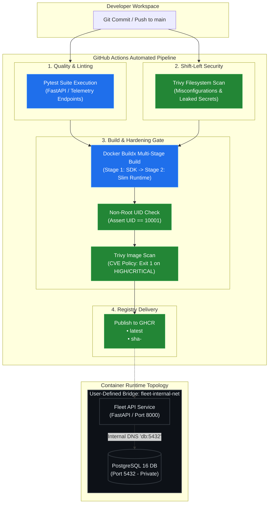

# Enterprise Fleet Telemetry: Hardened Container Architecture & CI/CD Pipeline

[](https://github.com/mdadilhussain07/enterprise-ci-cd-fleet/actions/workflows/ci.yml)
[](https://github.com/mdadilhussain07?tab=packages)
[-success?logo=shield&logoColor=white)](#security-architecture)
[](#automated-security-gates)

Production-grade microservices container architecture and automated Continuous Integration (CI) delivery pipeline featuring **Multi-Stage Docker builds**, **least-privilege non-root execution contexts**, **dependency health gating**, and **static vulnerability gating via Trivy**.

Published OCI container images are signed and versioned via **GitHub Container Registry (GHCR)** with semantic Git SHA traceability.

---

## Architecture & CI/CD Delivery Pipeline



---

## Architectural Highlights

### 1. Multi-Stage Build Optimization
* **SDK / Build Isolation:** Build-time compilers (`build-essential`, `libpq-dev`) are isolated in the intermediate builder stage and dropped from the final runtime image.
* **Footprint Reduction:** Reduces container image size from **~1 GB** (standard full SDK) down to **64.5 MB**.
* **Attack Surface Elimination:** Eliminates package managers and compiler binaries from the production runtime.

### 2. Security Hardening & Principle of Least Privilege
* **Non-Root Execution:** Container executes under dedicated user `appuser` with UID `10001` and primary group `10001`, blocking root privilege-escalation vectors.
* **Shell Restriction:** The service user is assigned `/usr/sbin/nologin` without interactive shell privileges.
* **Embedded Healthcheck:** Configured native Docker daemon healthcheck polling (`/healthz`) to enable orchestrator self-healing.

### 3. Isolated Networking & Health-Gated Startup
* **Zero-Leak Ports:** The PostgreSQL database is attached to a user-defined bridge network (`fleet-internal-net`). Port `5432` is not bound to the host interfaces (`0.0.0.0`), preventing external network access.
* **Service Discovery:** Microservices communicate using Docker's embedded DNS resolver (`127.0.0.11`) using container names (`db:5432`).
* **Condition-Gated Initialization:** The API container enforces `condition: service_healthy` on PostgreSQL before starting, preventing startup race conditions and database connection crashes.

---

## Automated Security Gates & Pipeline Controls

The repository implements strict gating inside `.github/workflows/ci.yml`:

| Pipeline Stage | Security Control | Failure Policy |
| :--- | :--- | :--- |
| **Filesystem Scan** | Scans repository for exposed API keys, private certificates, and Dockerfile misconfigurations via Trivy. | `exit-code: 1` (Blocks build) |
| **Security Context Gate** | Asserts runtime user UID is non-zero (`id -u != 0`). | `exit 1` if UID == 0 |
| **Package Vulnerability Gate**| Scans application package manifests against Aqua Security vulnerability databases. | `exit-code: 1` on `HIGH` or `CRITICAL` findings |
| **Promotion Gate** | OCI image publishing to GHCR is restricted to successful builds originating from `main` or semantic release tags. | Pull Requests cannot push artifacts |

---

## Local Verification & Runbook

### Run the Multi-Container Stack Locally
```bash
# 1. Bring up the stack with healthcheck gating
docker compose up -d --build

# 2. Verify container states and healthcheck status
docker compose ps

# 3. Test API and database integration
curl -i http://localhost:8000/healthz

# 4. Teardown stack and purge persistent volumes
docker compose down -v
```

### Pull and Run Directly from GitHub Container Registry
```bash
docker pull ghcr.io/mdadilhussain07/enterprise-ci-cd-fleet/fleet-telemetry:latest
docker run -d -p 8000:8000 ghcr.io/mdadilhussain07/enterprise-ci-cd-fleet/fleet-telemetry:latest
curl http://localhost:8000/api/v1/info
```
